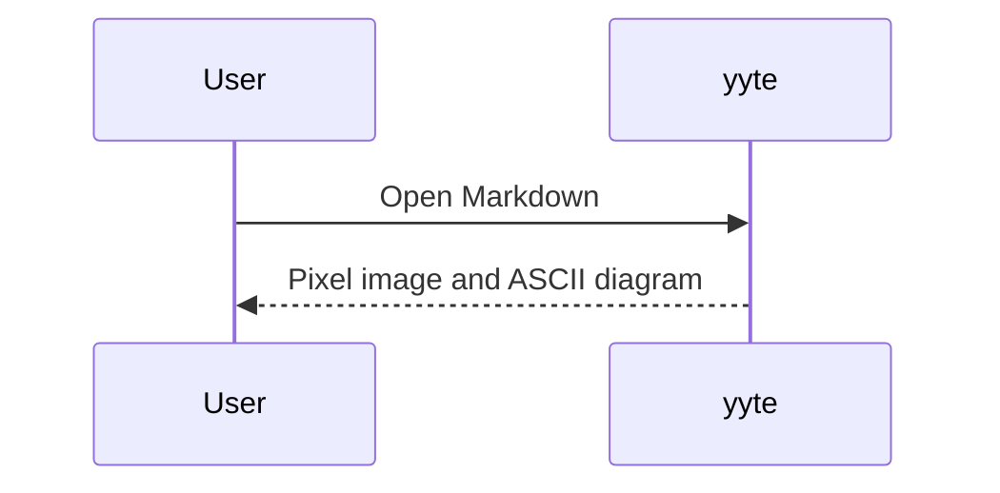
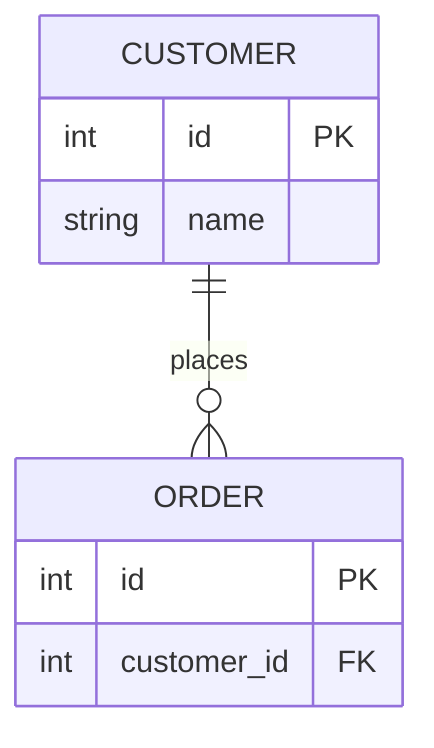
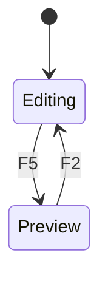

# Terminal Markdown preview

This file works in yyte (F5) and markdownViewer.

## Flowchart

## Sequence

## Entity relationships

## State

- [x] Local images
- [x] Text diagrams
- [ ] Exact browser layout (not required)

## Spreadsheet-style table

| Item / 項目 | Quantity / 数量 | Status / 状態 | Notes / 備考 |
| :--- | ---: | :---: | :--- |
| **顧客一覧** | 1,234 | Ready | Japanese text wraps inside the cell; every column stays aligned. |
| `records.dat` | 42 | Review | Fixed-length records with packed decimal fields |
| [Markdown guide](../docs/user/help.md) | 100000 | Done | Read-only preview with column letters and row numbers. |
