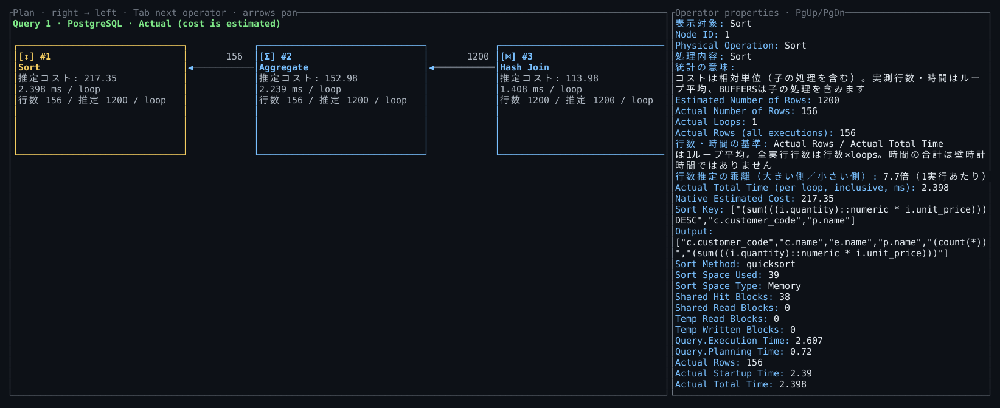
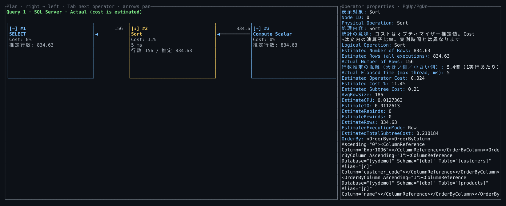
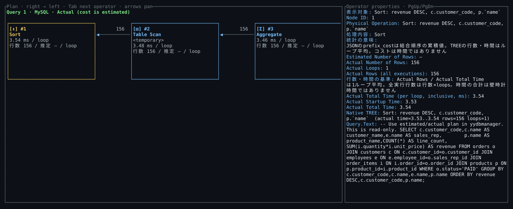
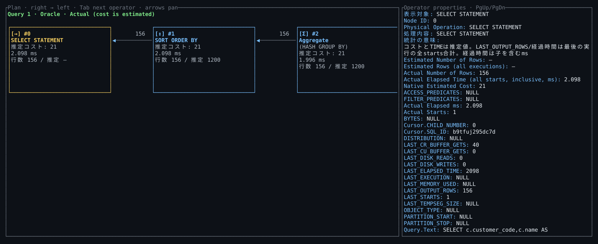
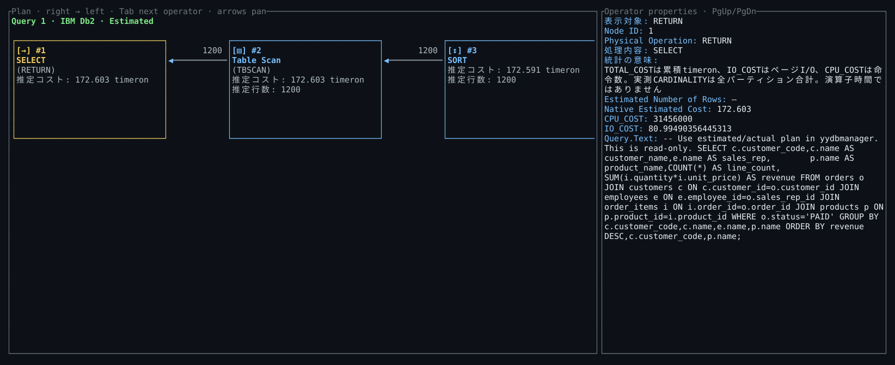

# 実行計画画面の出力例

yydbmanagerと同じDocker Composeの受注データに対する5表結合・集計・ソートの実行計画です。アプリ本体の実行計画ペインの描画関数を180×36セルの端末バッファへ出力し、色・文字・位置をSVGへ変換しています。

SQLは共通デモの `sql/02-join-and-plan.sql`。PostgreSQL・MySQL・SQL Server・Oracleは実測計画、Db2は推定計画です。実測行数や経過時間はこの取得時の値で、実行条件によって変わります。

## 読み方

入力は右側、結果は左側です。枠は演算子、矢印は行の流れ、Cost %は文内の推定コスト比率、推定コストはDBごとの単位で表示します。黄色の枠は選択中の演算子で、右側に型・コスト・実測行数・DB固有の統計を表示します。画面外の演算子は矢印キーやホイールで移動し、Tabで選択を切り替えます。

全演算子を同時に縮小表示せず、文字の大きさを維持してスクロールする画面です。狭い端末ではプロパティを下側に配置します。

## PostgreSQL：実測計画



[同じ出力をテキストで読む](plan-examples/postgres.txt)

## SQL Server：実測計画



[同じ出力をテキストで読む](plan-examples/sqlserver.txt)

## MySQL：実測計画



[同じ出力をテキストで読む](plan-examples/mysql.txt)

## Oracle：実測計画



[同じ出力をテキストで読む](plan-examples/oracle.txt)

## Db2：推定計画



[同じ出力をテキストで読む](plan-examples/db2.txt)

## 再現する

共通デモを起動して実接続試験を実行し、成功したレポートフォルダーを指定します。DBやSQLを複製せずに同じ例を再取得できます。

```sh
python tools/test_database_live.py --yyeditor ../yyeditor --up
python tools/render_plan_examples.py target/database-live/<成功した実行時刻>
```

Db2実測計画には別途activityモニター等の準備が必要です。この共通デモの既存シナリオには含まれず、上のDb2画面を実測計画として扱わないでください。操作と取得形式は [データベース機能](database.md) を参照してください。
